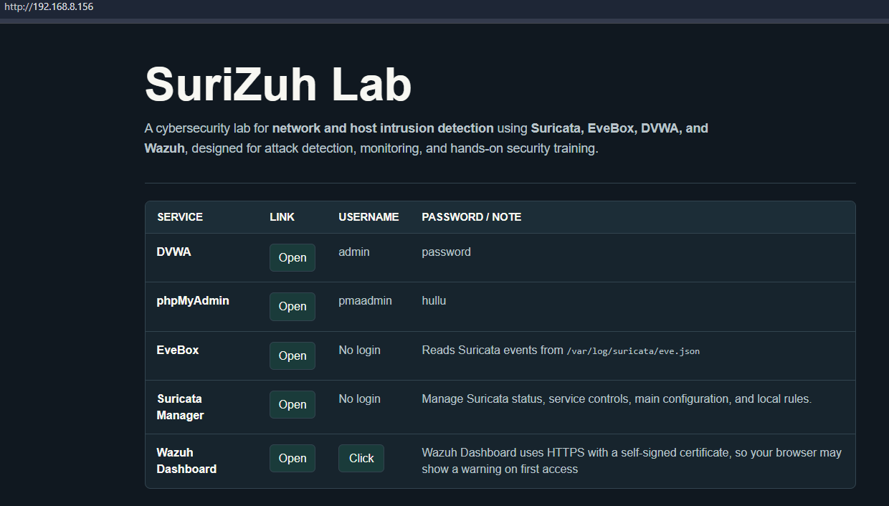

# SuriZuh Lab

This repository provides a **step-by-step basic guide** for using the **SuriZuh VMware VM**,
a lightweight **Network and Host Intrusion Detection System (IDS) lab** for learning
**Suricata**, **Wazuh**, **EveBox**, and **DVWA**.

The VM is built for students who want to practise basic blue-team monitoring in one small lab.
It combines network detection, host monitoring, vulnerable web application testing, and web dashboards.

---

## Screenshot



---

## VM Download

- Download the compressed VMware image from SourceForge:
  https://sourceforge.net/projects/surizuh/files/

After downloading:

```bash
7z x SuriZuh.7z
```

Then open the extracted VM folder in VMware.

---

## What Is Inside the VM

- Debian GNU/Linux 13.6 server without GUI
- Apache 2.4.68 web server
- MariaDB 11.8.6 and phpMyAdmin 5.2.2
- PHP 8.4
- DVWA Git snapshot `d45ba3c`
- Suricata IDS 7.0.10
- EveBox 0.27.0
- Wazuh Manager 4.14.7
- Wazuh Indexer 4.14.7
- Wazuh Dashboard 4.14.7
- Suricata Manager custom Flask app
- Python 3.13.5, Flask 3.1.1, and Werkzeug 3.1.3
- OpenSSH 10.0p2

This VM is designed for **learning, detection, and alert analysis**.

---

## How This Can Be Used in a Lab

SuriZuh can be used as the main monitoring VM in a small cyber security lab.

Lab VMs can be placed on the same virtual network, and they should be able to reach each other.

Common lab scenarios include:

- **Attacks targeting SuriZuh directly:** Students can run attacks, scans, or web testing against DVWA, Apache, SSH, phpMyAdmin, or other exposed lab services. If suitable Suricata rules are enabled, network attacks targeting the SuriZuh VM should be detected.
- **Attacks between other lab VMs:** SuriZuh can monitor traffic between other VMs when Suricata can see that traffic. In VMware or VirtualBox labs, this usually means placing the VMs on the same virtual network and enabling promiscuous mode where required.
- **Endpoint logging with Wazuh Agent:** An attacking VM can target a Windows VM while the Windows VM reports security events and system logs to SuriZuh through the Wazuh Agent.

Students can then compare:

- Network alerts from Suricata
- Linux host alerts from the SuriZuh server
- Windows host alerts from the Wazuh Agent

This makes the lab useful for practising both **network intrusion detection** and **host intrusion detection**.

---

## Main Lab Flow

SuriZuh can be used in three main lab flows.

### Direct Monitoring Flow

This flow focuses on attacks against services running on the SuriZuh VM.

1. Open the lab home page.
2. Open DVWA, Apache, SSH, phpMyAdmin, or another exposed lab service.
3. Open Suricata Manager and enable a suitable rule for the traffic you want to detect.
4. From Kali, run web attacks, scans, or traffic tests against the SuriZuh VM.
5. Check Suricata alerts in EveBox.
6. Check related alerts in Wazuh Dashboard.

This helps students understand how attacks against the monitoring VM itself can be detected.

### Network IDS Flow

This flow focuses on attacks between other lab VMs.

1. Place the lab VMs on the same virtual network.
2. Enable promiscuous mode where required so Suricata can see traffic between VMs.
3. Run attacks, scans, or traffic tests from one VM against another VM.
4. Check Suricata alerts in EveBox.
5. Check Suricata alerts in Wazuh Dashboard.
6. Edit local Suricata rules and test the same traffic again.

This helps students understand how network attacks can be detected when the sensor can see the traffic.

### Host IDS Flow

This flow focuses on endpoint logs, host activity, and Wazuh alerts.

1. Open Wazuh Dashboard.
2. Review alerts from the SuriZuh server itself.
3. Add another VM, such as Windows, and install the Wazuh Agent on it.
4. Configure the agent to send logs to the SuriZuh Wazuh Manager.
5. Run activity on the endpoint, such as login attempts, file changes, or service changes.
6. Review endpoint security events and system activity in Wazuh Dashboard.

This helps students compare network intrusion detection with host intrusion detection.

---

## Default Access

The VM console shows the current lab URL after boot.

Default local users:

```text
hullu / hullu
root / hullu
```

Use the VM IP address shown on the login screen.

Example:

```text
http://<VM-IP>/
```

If `sudo` is not installed in the VM, log in as `root` or use `su -`, then run:

```bash
apt update
apt install sudo -y
usermod -aG sudo hullu
```

After that, log out and log back in as `hullu`.

---

## Web Interfaces

### Lab Home

The home page links to the main lab services.

```text
http://<VM-IP>/
```

### DVWA

DVWA is used as the vulnerable web target for testing attacks and generating alerts.

```text
http://<VM-IP>/dvwa/
```

### phpMyAdmin

phpMyAdmin is used to manage the MariaDB database used by DVWA.

```text
http://<VM-IP>/phpmyadmin/
```

### EveBox

EveBox is used to view Suricata alerts from `eve.json`.

```text
https://<VM-IP>:5636
```

Browsers may show a warning because EveBox uses a self-signed certificate.

### Wazuh Dashboard

Wazuh Dashboard is used to view host alerts, Suricata alerts, and agent activity.

```text
https://<VM-IP>/
```

The Wazuh password file can be viewed from the lab home page.

### Suricata Manager

Suricata Manager is a small web interface for controlling Suricata and editing approved files.

```text
http://<VM-IP>:8080/
```

It can be used to:

- Check Suricata status
- Start Suricata
- Stop Suricata
- Restart Suricata
- Test the Suricata configuration
- Edit `/etc/suricata/suricata.yaml`
- Edit `/var/lib/suricata/rules/local.rules`
- List Suricata log file names

Suricata Manager does not show log content. Use Wazuh and EveBox for log and alert analysis.

---

## Useful Commands

Check Suricata:

```bash
systemctl status suricata
```

Start Suricata:

```bash
systemctl start suricata
```

Stop Suricata:

```bash
systemctl stop suricata
```

Restart Suricata:

```bash
systemctl restart suricata
```

Test Suricata configuration:

```bash
suricata -T -c /etc/suricata/suricata.yaml -i ens33
```

Edit local Suricata rules:

```bash
nano /var/lib/suricata/rules/local.rules
```

Edit Suricata configuration:

```bash
nano /etc/suricata/suricata.yaml
```

Restart Wazuh Manager:

```bash
systemctl restart wazuh-manager
```

---

## Wazuh Vulnerability Detection

Wazuh Vulnerability Detection is disabled in this VM to reduce disk usage and keep the compressed VM smaller.

Students can enable it later with:

```bash
sed -i '/<vulnerability-detection>/,/<\/vulnerability-detection>/ s/<enabled>no<\/enabled>/<enabled>yes<\/enabled>/' /var/ossec/etc/ossec.conf
systemctl restart wazuh-manager
```

Check the setting:

```bash
grep -A4 "<vulnerability-detection>" /var/ossec/etc/ossec.conf
```

The output should include:

```xml
<enabled>yes</enabled>
```

---

## Installing a GUI

The VM uses Debian server without a graphical desktop to keep it lighter.

Students who want a GUI can install XFCE:

```bash
apt update
apt install xfce4 lightdm -y
reboot
```

During the installation, select **lightdm** if Debian asks for the default display manager.

---

## Notes for Students

- Use this VM only in a lab network.
- DVWA is intentionally vulnerable.
- Suricata detects network traffic.
- Wazuh detects host activity and can also show Suricata alerts.
- EveBox is useful for viewing Suricata alerts directly.
- You can edit Suricata rules and test how alerts change.

---

## Contact, Support, and Suggestions

This lab VM is provided for **educational use**.

If you encounter issues, have questions, or would like to suggest improvements,
please use one of the following:

- **GitHub Issues:**
  Open an issue in this repository for bugs, errors, or suggestions.

- **Pull Requests:**
  Improvements to documentation are welcome via pull requests.

This project is maintained on a **best-effort basis** and primarily intended for
teaching and learning purposes.

**Maintained by:**
Kaled Aljebur
